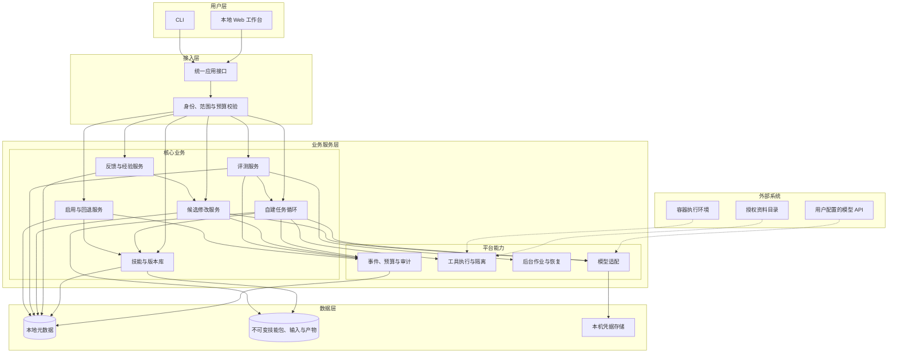
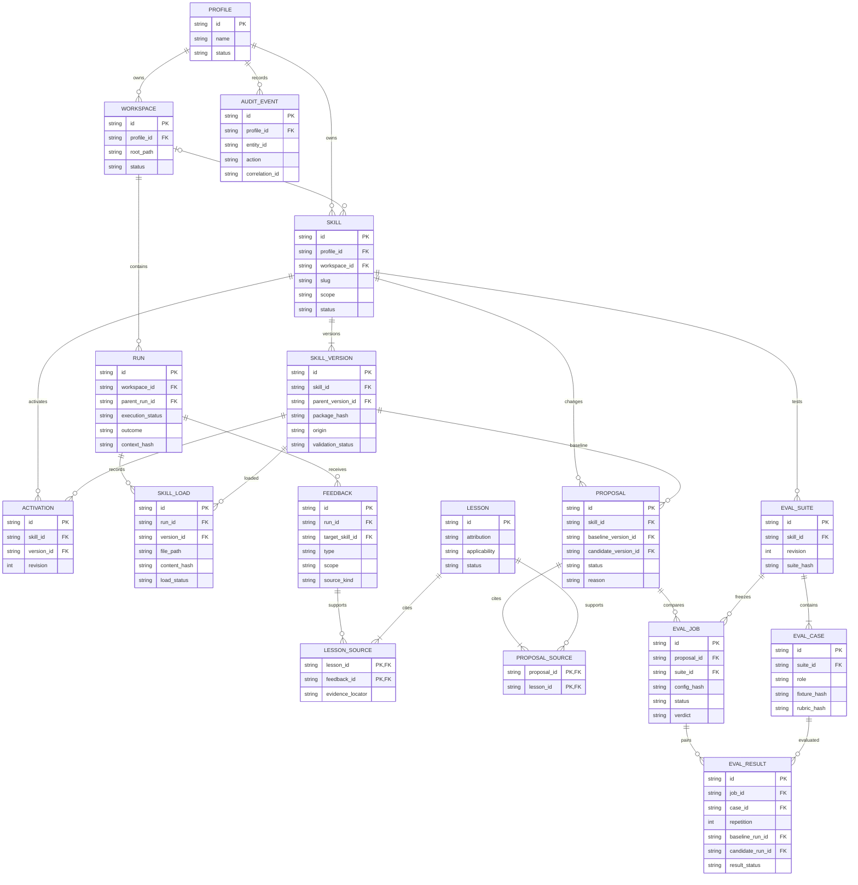
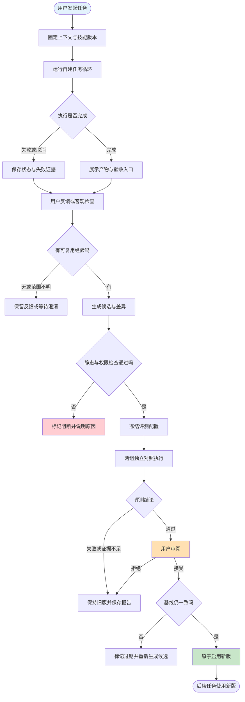
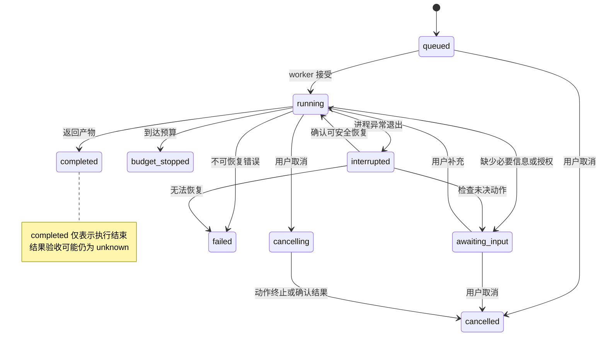
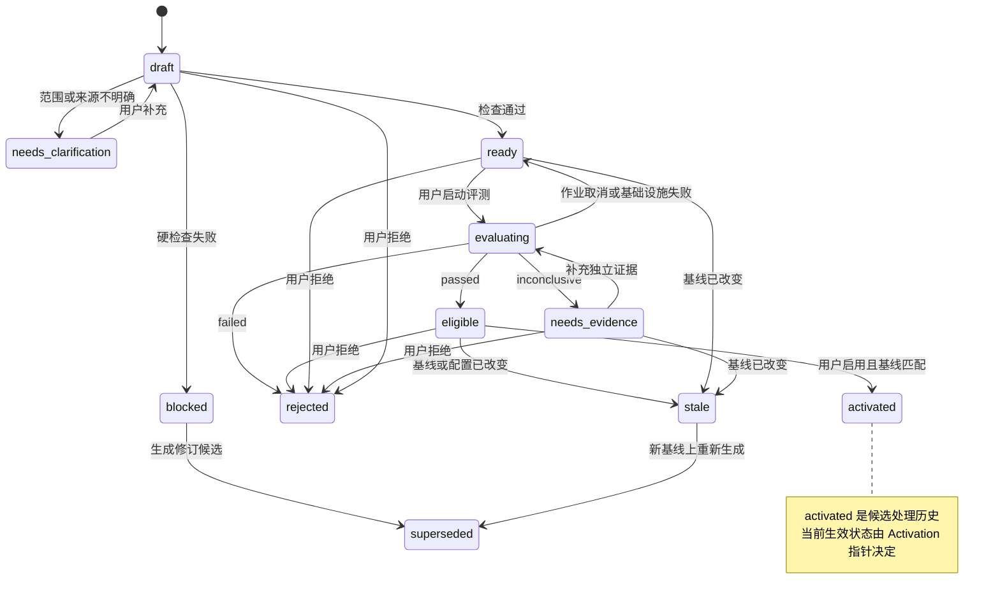
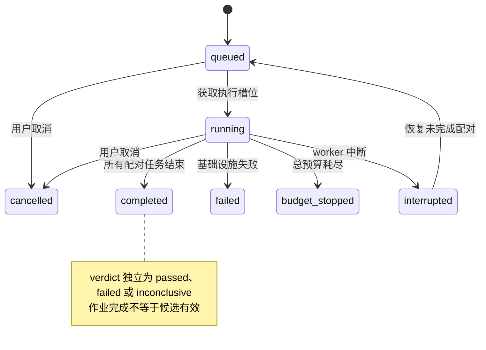

# Skills 自进化框架 PRD（v0.1）

> 工作名称：Skills 自进化框架。长期产品方向：能逐渐学会用户做事方式的Personal Agent。

| 文档信息 | 内容 |
| --- | --- |
| 版本 | v0.1；P0 skills 自进化闭环（67 条需求） |
| 需求提出人 / 产品决策人 | gxy |
| 编写 | deepseek harness，依据当前讨论整理 |
| 审核人 | gxy；技术审核角色在开发启动前指定 |
| 创建日期 | 2026-10-08，xy/Sichuan |
| 最后更新 | 2026-10-12，xy/Sichuan |
| 重要性 | 高：确定新项目核心方向与开发边界 |
| 紧迫性 | 尚无明确上线日期，按阶段验收推进 |
| 产品类型 | 暂按个人工具产品 × 可复用基础能力设计，先自用验证；商业化方式未决定 |
| 本期目标 | 从零开发独立的 skills 进化产品，跑通执行、反馈、候选修改、对照评测、启用与回退 |
| 当前基线 | 项目已有 PRD 文档，暂无应用实现、接口或测试；不继承任何现成 Agent 的运行时 |

## 产品摘要

首期交付一个能独立运行的本地产品：用户导入自己的 skill，系统完成任务并记录实际使用的方法；用户纠正后，系统提出可审阅的候选修改，在独立环境重新执行新旧版本，形成效果报告；用户决定启用、试用或保持原版。

核心学习单位是有来源、有适用条件、可验证的做事方法。临时要求默认限当前任务，项目方法限当前工作区，跨项目个人方法需要明确范围。效果以减少重复纠正、保持质量为目标，技能数量与文字增长不作为成功指标。

本地 Web、CLI、自建任务循环、技能库、反馈、候选、评测和版本恢复构成 P0。个人记忆、持续任务和主动跟进属于后续阶段，不在本期范围。部署、模型、技术栈和数值门槛是初稿建议，待决事项集中在第 14 章。

## 阅读导航

- [1、项目背景](#1项目背景)
- [2、需求基本情况](#2需求基本情况)
- [3、产品定位与参考分析](#3产品定位与参考分析)
- [4、项目收益目标与验收口径](#4项目收益目标与验收口径)
- [5、项目方案概述](#5项目方案概述)
- [6、项目范围](#6项目范围)
- [7、项目风险与前提假设](#7项目风险与前提假设)
- [8、术语和缩略语](#8术语和缩略语)
- [9、参考资料与决策来源](#9参考资料与决策来源)
- [10、功能需求与目标架构](#10功能需求与目标架构)
- [11、数据记录与效果分析](#11数据记录与效果分析)
- [12、权限与数据边界](#12权限与数据边界)
- [13、交付、试点与验收计划](#13交付试点与验收计划)
- [14、待决事项](#14待决事项)
- [附录 A：端到端验收场景](#附录-a端到端验收场景)
- [附录 B：文档自检与待补充信息](#附录-b文档自检与待补充信息)

## 1、项目背景

### 1.1 已确认的方向

| 编号 | 用户已确认决策 | 产品影响 |
| --- | --- | --- |
| D-01 | 构建 skills 自进化框架，参考 Hermes 的经验学习思路 | 核心业务是技能改进，而非仅管理技能文件 |
| D-02 | 完整个人 Agent 是值得探索的长期方向 | 技能要能承载个人做事方法，后续连接用户记忆与持续任务 |
| D-03 | 可以从独立进化层开始 | 首阶段围绕学习闭环形成可复用能力 |
| D-04 | 不使用 Hermes 接入，完全独立开发 | 自建运行时、数据、工具执行、评测和交互；Hermes 不作为库、服务或必要运行环境 |
| D-05 | 先产出完整 PRD | 本轮交付文档，不进行应用实现、部署或外部发布 |

### 1.2 要解决的问题

以下痛点依据讨论形成，属于待试点验证的产品假设，目前没有用户量或使用效果数据。

1. 用户在不同任务中反复解释同一种工作方法，纠正很难跨会话复用。
2. Skill 经常停留在人工编写阶段，实际执行暴露的问题没有进入维护闭环。
3. 自动复盘容易把单次经历写成通用规则，造成指令膨胀、互相矛盾或过度拟合。
4. 修改之后缺少新旧版本对照，无法区分文字变长与能力改善。
5. 用户无法清楚查看修改依据、适用范围与版本效果，出了问题也难以恢复。

### 1.3 解决思路

建立独立的任务执行与技能学习系统。每次执行固定实际使用的 skill 版本，保留最小必要证据；从用户纠正与可验证结果中提出候选修改；通过静态检查与重新执行的对照评测决定是否具备启用条件；由用户审阅后启用，并支持完整包回退。

产品对外回答三个问题：这次任务用了哪些方法；系统建议学到什么；下一次为什么会做得不同。

## 2、需求基本情况

### 2.1 用户与任务

| 要素 | 定义 |
| --- | --- |
| 首位用户 | gxy，兼任初期技能维护者与结果验收人 |
| 后续目标用户 | 已使用 Agent 和 skills，且有重复知识工作需求的个人用户 |
| 核心任务 | 有稳定方法、能得到产物、会发生用户纠正的工作，如文档编写、资料整理、结构化分析 |
| 产品消费对象 | 用户本人；未来其他 Agent 可消费导出的技能包，首期不要求接入 |
| 使用频率假设 | 每周至少完成 3 次同类任务，持续 2～4 周，用于验证学习价值 |
| 首期部署 | 本机运行，单用户，多工作区；调用用户配置的模型服务 |

### 2.2 核心场景

| 场景 | 起因与过程 | 期望结果 |
| --- | --- | --- |
| S-01 导入已有技能 | 用户选择一个 SKILL.md 技能目录，查看文件和权限需求后复制导入 | 创建可追踪的完整包版本，原目录不被修改 |
| S-02 独立完成任务 | 用户给出资料、要求和工作区；系统选择或按指定 skill 执行 | 返回产物、完成状态、实际使用版本及验收入口 |
| S-03 从纠正中学习 | 用户指出结果缺少证据，说明以后同类任务都需要验证 | 系统提炼规则、归因到具体步骤，生成候选差异 |
| S-04 限定当前任务 | 用户说“这次只保留一页”，没有要求长期沿用 | 更新当前任务要求，不擅自改写通用 skill |
| S-05 比较新旧方法 | 用户选择代表性任务与验收规则，启动对照执行 | 获得配对结果、回归项、成本和证据充分性结论 |
| S-06 启用改进版本 | 候选通过评测，用户审阅修改与权限变化后启用 | 新任务使用新版，已运行任务保留原快照 |
| S-07 回退错误改进 | 用户发现新版在其他场景退化，选择历史版本 | 恢复完整技能包，保留历史任务和修改证据 |
| S-08 首次学习方法 | 用户没有现成技能，提供操作说明和一个示例 | 生成待审阅草稿；检查和验证后可人工启用，标记“初始版本，效果未验证” |

### 2.3 用户旅程

首次配置模型 → 导入或编写一个 skill → 独立完成任务 → 验收并纠正 → 查看学习建议 → 运行对照 → 审阅启用 → 在下一次任务中观察效果。

新用户第一次成功的定义：完成一次有实际产物的任务，并看到一条有来源、可审阅的学习建议。该定义不要求第一次修改即有效。

## 3、产品定位与参考分析

### 3.1 一句话定位

面向希望持续复用自己工作方法的个人用户，提供能独立执行任务、从反馈改进 skills、用证据管理版本效果的本地产品。

### 3.2 产品价值

| 用户诉求 | 产品提供 | 验证方式 |
| --- | --- | --- |
| 少重复解释 | 把适用于同类任务的纠正转化为有范围的技能规则 | 后续同类任务的重复纠正次数 |
| 结果更稳定 | 固定技能版本、验收规则与回归集 | 首轮通过率、关键检查失败数 |
| 理解它学到了什么 | 展示来源、修改理由、差异和效果报告 | 用户能否判断接受或拒绝，无需读完整日志 |
| 保持控制 | 明确启用、完整回退、限定作用域 | 启用与回退成功率、越界修改数 |

### 3.3 参考分析及其边界

| 参考对象 | 已核对的能力 | 本项目设计启发 |
| --- | --- | --- |
| Hermes skills 系统 | 按需加载、skill 创建与修改、任务后后台复盘 | 将技能视为程序性知识，任务经验可触发维护 |
| Hermes curator 与 ledger | 使用记录、生命周期维护、归档和变更恢复 | 内容、使用记录和恢复证据分别管理 |
| 用户现有 SKILL.md 工作方式 | 本次讨论要求围绕 skills 自进化，现有可用技能涵盖多种知识工作 | 支持已有技能资产，逐步验证个人工作方法 |

上述比较仅说明参考机制。未进行市场规模、价格、份额或全量竞品评测，不据此宣称独家能力或领先效果。

### 3.4 商业与开放策略

首阶段采用自用验证、用户自备模型配置的方案。是否开源、许可证、收费、托管服务与分发渠道放入第 14 章决策表。首期不建设计费、账户体系、公共技能市场或 SaaS 多租户能力。

## 4、项目收益目标与验收口径

> 方法：功能交付门禁与用户效果目标分开；下列数值是初稿建议，均不是已取得的数据。

### 4.1 功能交付目标

| 目标 | 本期交付门禁 | 证据 |
| --- | --- | --- |
| 独立运行 | 在干净环境按安装文档启动，完成任务与学习闭环；无 Hermes 或外部 Agent 宿主依赖 | 安装记录、真实模型运行记录、产物 |
| 过程可追溯 | 所有完成任务记录加载版本、结果状态；所有候选关联来源、基线和完整包 hash | 导出包、数据库一致性检查 |
| 修改可控制 | 自动启用为关闭状态；硬检查失败不得启用；启用使用乐观并发校验 | 正常与冲突验收记录 |
| 评测可信 | 实际调用模型执行两组任务，冻结模型配置和验收集；输出真实次数与失败分类 | 配对评测报告、逐案产物 |
| 恢复可靠 | 对文档、references、scripts 的完整包启用与回退全部通过；不改变既有运行快照 | 包 hash 对照、故障恢复记录 |

### 4.2 首轮试点效果目标

以 2～4 周、至少 3 个技能、30 次实际任务为试点建议规模。只有同类任务和可比配置进入效果分析。

| 指标 | 建议目标 | 口径 |
| --- | --- | --- |
| 重复纠正次数 | 每任务均值较基线降低至少 20% | 只统计同一已学习规则被再次纠正的事件 |
| 首轮验收通过率 | 不低于基线，且至少一个任务类型有改善 | 必须有显式用户验收或客观 verifier，unknown 不算通过 |
| 可验证的技能改进 | 至少 2 个技能产生被接受且后续复用的改进版本 | 候选完成对照、启用后至少有 3 次新任务使用 |
| 复盘负担 | 学习建议默认每任务最多 1 张汇总卡，用户中位审阅时间不超过 2 分钟 | 可拒绝、不强制提交反馈 |
| 总成本 | 报告任务成本与学习成本；学习预算超限次数为 0 | 缺价格时显示 token 与调用数，不虚构金额 |

样本不足时报告“试点证据不足”，不外推成功率或宣称持续成长已得到证明。

### 4.3 非功能目标

目标验收环境：单用户本机，10,000 次任务记录、200 个 skill、最多 2 个任务执行 worker；硬件基准在开发启动前记录。

- 本地列表、详情查询 p95 ≤ 1 秒；提交操作在 1 秒内返回任务编号，模型耗时另计。
- 取消请求 2 秒内停止派发新动作；子进程在 10 秒内终止，无法取消的模型请求状态如实显示。
- 成功提交的元数据在进程异常退出后仍可恢复；核心状态迁移具备幂等性。
- 输入、事件、产物、技能包可导出备份并恢复；明确不承诺进程被强杀前尚未落盘的流式片段。
- 支持中文和英文 skill；首期产品界面与帮助文档以中文为主。

## 5、项目方案概述

### 5.1 产品组成

| 模块 | 能力 | 优先级 |
| --- | --- | --- |
| 本地工作台 | 发起任务、查看产物、提交反馈、审阅修改和版本 | P0 |
| 自建任务运行时 | 调用模型、按需加载 skill、执行受约束工具、持久化状态 | P0 |
| 技能库 | 导入、草稿、完整包版本、作用域、按需加载 | P0 |
| 反馈与经验 | 用户纠正、验收、复盘、来源定位和归因 | P0 |
| 候选修改 | 生成差异、检查冲突、静态验证、人工审阅 | P0 |
| 评测中心 | 独立工作副本中的配对执行、回归与盲评 | P0 |
| 启用与恢复 | 版本切换、冲突拦截、回退、备份 | P0 |
| 个性化与持续任务 | 用户稳定偏好、项目背景、待办与跨会话继续；具体能力范围在 P1 阶段另立范围与验收门禁 | P1 |
| 自动维护与扩展接入 | 自动启用策略、拆分合并、MCP 和可选其他 Agent 适配 | P2 |

P0＝首期发布必需；P1＝下一阶段；P2＝后续探索。阶段标签不代表已交付。

### 5.2 核心设计

一个独立核心包对本地 Web 和 CLI 暴露相同服务接口。用户任务由自建 Agent Loop 执行；进化作业在独立后台队列运行，读取不可变执行证据，只写候选及评测结果。P0 只保存当前 run 的任务上下文；个人记忆与持续任务能力在后续阶段引入，权限判断、状态迁移、启用与回退由确定性代码处理。

本地 Web 是日常主入口，CLI 支持初始化、导入导出、任务和评测等操作。首期不需要桌面客户端、公网服务器或第三方 Agent。建议 Python 核心、SQLite 元数据和文件制品存储；具体库在技术设计阶段决定。

### 5.3 首期核心假设

- 用户纠正能被准确区分为“当前任务要求”与“长期方法”。
- 小范围修改比整体重写更容易验收和归因。
- 对照执行与人工审阅可以筛除明显退化的候选。
- 学习负担与额外模型费用低于重复指导的收益。

## 6、项目范围

### 6.1 P0 必须独立具备

模型配置、本地资料读写、自建任务循环、技能选择与加载、实际执行记录、反馈、候选修改、冻结评测集、配对执行、人工启用、回退和备份。所有能力在同一新项目中开发。

独立开发允许使用通用开源库、容器运行环境和模型 API；不得将既有 Agent 作为核心任务执行宿主。SKILL.md 文件格式兼容不等于运行能力自动兼容，导入时必须检查工具要求。

### 6.2 系统边界

| 对象 | 本期关系 | 责任边界 |
| --- | --- | --- |
| 模型服务 | 外部推理依赖，用户配置 | 本项目管理调用、重试、预算和记录，不训练模型 |
| 本机文件与工作区 | 用户授权输入和产物目录 | 严格限定路径；原 skill 导入来源只读 |
| 容器运行环境 | 隔离脚本、命令和评测任务 | 本项目配置权限与资源；未就绪时禁止执行相关任务 |
| Hermes | 概念和公开机制参考 | 不作为实现依赖，不要求导入其状态数据库 |
| Hermes | 不接入、不复用其运行时 | 不配置其模型、工具或数据目录 |
| Codex / Claude Code 等 | 未来可选导出消费方 | P0 无依赖，不要求读取其私有会话格式 |

### 6.3 后续阶段

P1：学习用户稳定偏好、任务状态跨会话恢复、项目背景与个人记忆。P2：定时与主动任务、消息渠道、MCP、自动启用、技能创建和整理自动化、可选其他 Agent 接入。每个阶段另立范围与验收门禁，具体设计在对应版本的 PRD 中定义。

### 6.4 首期排除项

公共技能市场、团队协作和权限组织树、计费与云同步、模型微调、无限制桌面控制、自动发送消息、后台主动操作外部系统、多 Agent 编排，以及根据调用频次自动删除 skills。

## 7、项目风险与前提假设

### 7.1 设计假设

| 编号 | 初稿假设 | 不成立时的调整 |
| --- | --- | --- |
| A-01 | 首期单用户、本地优先，自备模型配置 | 云产品需重新设计账户、隔离、密钥和运维 |
| A-02 | 先验证文档与资料类任务 | 如果首个场景变为代码或桌面任务，替换工具与评测集，保留版本闭环 |
| A-03 | 首期人工启用，学习建议可自动产生 | 自动启用必须增加独立效果门禁和授权策略 |
| A-04 | 首期允许安装容器环境以执行脚本和评测 | 无容器时只运行无需命令的资料任务，脚本类功能明确不可用 |
| A-05 | 首批运行环境为 macOS，兼顾 Linux | Windows 支持另行验证，不宣称首期兼容 |

以上为建议假设，不是用户已经确认的需求；第 14 章列明确认时间与默认方案。

### 7.2 风险与应对

| 风险 | 影响 | 应对 |
| --- | --- | --- |
| 错误归因 | 把模型不遵循或工具故障写成 skill 规则 | 记录实际加载与工具结果；归因类别含 unknown；允许不生成修改 |
| 过拟合与自证 | 候选只修复原样例、模型给自己高分 | 独立冻结验收集、保留未用于学习的样例、盲评和用户裁决 |
| 指令膨胀 | 后续任务成本上升、规则互相冲突 | 改动预算、重复与矛盾检查、长内容移入引用、检查加载成本 |
| 反馈矛盾 | 同一规则被反复覆盖 | 来源保留、范围区分、人工决策；旧反馈不因时间晚自动失效 |
| 任意执行与越权 | Skill 的脚本或提示改变权限边界 | Skill 视为任务资料；脚本隔离；权限由程序校验；修改不能给自己授权 |
| 环境漂移与并发修改 | 报告无效或覆盖用户修改 | 冻结配置和包 hash、启用时校验基线、失败后重新评测 |
| 学习成本过高 | 用户收益抵不过复盘与模型费用 | 预算上限、按需评测、最多一张汇总建议、独立计费记录 |
| 实际采纳低 | 用户觉得维护技能比直接指导更麻烦 | 小规模自用试点，记录拒绝原因；依据效果决定是否扩展 |

## 8、术语和缩略语

| 术语 | 本文定义 |
| --- | --- |
| Skill | 针对一类任务的适用条件、步骤、失败处理、验证方法，以及按需加载的资料或脚本 |
| Skill package | SKILL.md 与 references、scripts 等全部受管理文件的完整包 |
| Run | 自建运行时的一次实际任务执行，有固定输入、配置、加载记录和状态 |
| Feedback | 用户验收、纠正或客观检查结果；有来源、范围与关联对象 |
| Lesson | 从证据中提炼的可复用经验，带归因和适用范围；尚不是生效规则 |
| Proposal | 基于一个确定版本生成的候选完整包与差异 |
| Eval suite | 冻结的评测样例、数据夹具、评分规则与预算集合 |
| Paired evaluation | 在同等配置、独立初始环境中重新执行基线版与候选版，配对比较 |
| Activation | 用户把某个包版本设为特定作用域的生效版本 |
| Rollback | 将生效指针切回可用的历史完整包；不撤销已经执行的业务动作 |
| Scope | personal 或 workspace，表示规则和技能的适用边界 |
| MCP | 可选工具接入协议，首期不构成核心依赖 |

任务状态存储本次工作进展，skill 存储做事方法。P0 只保留任务执行所需的有限上下文，不等同于完整的个人记忆系统。

## 9、参考资料与决策来源

| 来源 | 位置 | 使用范围 |
| --- | --- | --- |
| 用户讨论与最新指令 | 当前项目对话，2026-10-08 | 独立开发、阶段方向、完整 PRD 的直接依据 |
| Hermes skills 文档 | [skills.md](https://github.com/NousResearch/hermes-agent/blob/main/website/docs/user-guide/features/skills.md) | 技能加载、维护和写入机制参考 |
| Hermes 后台复盘 | [background_review.py](https://github.com/NousResearch/hermes-agent/blob/main/agent/background_review.py) | 执行与复盘解耦参考 |
| Hermes 生命周期管理 | [curator.py](https://github.com/NousResearch/hermes-agent/blob/main/agent/curator.py) | 可恢复维护、范围控制参考 |
| Hermes 变更记录 | [skill_ledger.py](https://github.com/NousResearch/hermes-agent/blob/main/tools/skill_ledger.py) | 完整变更证据和恢复参考 |

参考代码和文档为此前只读核对的指定版本内容，随上游变更；本项目未复制实现。技能格式的兼容范围须在开发阶段对固定版本规范验证。

## 10、功能需求与目标架构

本章所有接口、数据模型、页面与状态均为目标设计，不代表已有实现。具体命令名与代码文件路径由技术设计确定。

### 10.1 产品框架

#### 10.1.1 目标应用架构

| 单元 | 责任 | 依赖与限制 |
| --- | --- | --- |
| 任务循环 | 为用户任务维护计划，逐次调用工具，返回结果 | 接受固定技能快照；不直接修改生效技能 |
| 技能库 | 管理完整包、身份、作用域和历史 | 不依赖模型判断进行状态写入 |
| 经验与候选 | 解释证据、提出有范围的改动 | 读取原始证据；仅写草稿与候选 |
| 评测服务 | 在独立环境重新执行并计算差异 | 冻结候选、模型、数据与评分规则；评测执行关闭学习 |
| 启用服务 | 切换生效指针、校验并发、回退 | 硬检查不可由模型绕过 |
| 队列与审计 | 作业去重、预算、事件、崩溃恢复 | 不将外部超时等同于任务内容失败 |

首期采用同一进程中的清晰模块与有限 worker，不要求分布式微服务。

#### 10.1.2 核心数据模型

| 实体 / 约束 | 明细规则 |
| --- | --- |
| Profile / Workspace | P0 仅一个本地 owner，多个授权工作区；技能可以是个人范围或绑定一个工作区 |
| Skill | `(profile_id, scope, workspace_id, slug)` 唯一；工作区字段为空表示个人范围；归档不抹去历史 |
| SkillVersion | 文件清单、每文件 hash、父版本、作者来源、完整包 hash；创建后不可变；语义版本号仅作展示 |
| Activation | 每个 skill 最多一个生效指针；revision 单调递增；回退产生新记录并递增 revision |
| Run | 输入和模型配置快照、工具集、预算、加载记录、产物、费用；execution_status 与 outcome 分开 |
| SkillLoad | 只有真正注入模型上下文的内容才计 loaded；索引推荐与全文加载分别记录 |
| Feedback | 原文、作者、反馈范围、目标步骤与产物定位；模型复盘标记 model，不伪装用户意见 |
| Lesson / 来源表 | 多反馈可支持同一经验；客观 verifier 结果先形成带 source_kind 的反馈记录；每个经验至少一条来源 |
| Proposal / 来源表 | 多经验可支持同一候选；可重建完整 candidate 包；删除、增添脚本须显式展示 |
| EvalSuite / Case | suite revision 不可变，修改生成新 revision；role 为 regression 或 holdout；夹具、评分、关键检查均冻结 |
| EvalJob / Result | 报告保留每个样例每次重复的两组运行；不覆盖失败记录；不完整结果不可标通过 |
| Artifact / RunEvent | 文件制品与顺序事件为辅助记录，分别保存 hash 和 run_id；事件具有递增序号；大正文不直接塞进业务表 |
| AuditEvent | 启用、回退、授权、备份、清除等操作可定位；缺失审计写入时禁止完成启用事务 |

#### 10.1.3 主业务流程

| 阶段 | 输出 | 结束条件 |
| --- | --- | --- |
| 执行 | Run、产物、加载和工具证据 | 完成、失败、取消或预算停止 |
| 学习 | Lesson、候选包、来源与差异 | 候选就绪、无需修改或等待范围确认 |
| 验证 | 冻结配置、逐案结果、结论 | passed、failed 或 inconclusive |
| 发布 | 用户选择、版本指针、审计 | 完成启用或保持原版本 |

#### 10.1.4 状态机

**任务执行状态：**

outcome 独立枚举：`unknown / accepted / rejected / partially_accepted`。预算停止、取消、失败默认 unknown；用户可评价已产生的部分产物。

**候选生命周期：**

**评测作业状态：**

| 对象 | 当前状态 / 事件 | 目标与约束 |
| --- | --- | --- |
| Run | completed 后用户验收 | 只更新 outcome，不倒改执行状态 |
| Proposal | 任意未终态遇基线变化 | 标记 stale；评测结果保留但不可用于启用 |
| Proposal | 用户编辑候选内容 | 创建新的不可变候选，旧候选 superseded；旧评测不能继承 |
| EvalJob | 任一基础设施错误或样本未完成 | 不授予 passed；保留记录并提供续跑或新建入口 |
| Skill | active → archived → active | 用户归档或恢复；归档排除新任务，历史任务仍可读取旧包 |
| Activation | 启用 / 回退 | 单事务、revision 校验、完整包就绪；不覆盖运行中任务快照 |

#### 10.1.5 工作台与功能清单

| 页面 | 主要信息 | 核心操作 | P0 |
| --- | --- | --- | --- |
| 任务工作台 | 请求、范围、进度、产物、验收 | 新建、补充、取消、反馈、查看学习建议 | 是 |
| 技能库与详情 | 技能用途、适用范围、当前版本、文件树 | 导入、草稿、编辑、归档、历史与回退 | 是 |
| 学习建议与候选详情 | 来源、理由、差异、风险、评测结果 | 澄清范围、编辑候选、评测、拒绝、启用 | 是 |
| 评测中心 | 样例、评分规则、运行状态、配对报告 | 建集、冻结、启动、取消、导出 | 是 |
| 设置与数据 | 模型连接、工作区、权限、预算、备份 | 检查连接、授权、导入导出、暂停学习 | 是 |

PC 本地浏览器为首期支持入口；不单独设计移动端和原生 App。普通页面优先展示任务与学习结果，技术日志、hash、原始 token 和事件放在可展开详情。

### 10.2 产品需求详解

#### 10.2.1 初始化、模型与工作区（REQ-SET-01～04）

**流程：**首次启动 → 配置模型连接 → 检查连接 → 选择工作区 → 导入或创建一个 skill → 发起任务。任何一步失败都保留非敏感输入并可重试。

| 交互区域 | 字段与默认值 | 操作及条件 |
| --- | --- | --- |
| 模型设置 | provider 类型、base URL、模型名、凭据引用；无预置真实账号 | 保存、检查连接；连接检查明确提示会发送最小测试请求 |
| 工作区 | 名称、可读目录、产物目录、允许工具；默认不授权任意目录 | 添加、移除、检查访问；路径变化需重新确认 |
| 权限与预算 | 文件读写、脚本执行、网络域名、调用和 token 上限 | 查看本次授权范围；拒绝时可继续不需要该权限的任务 |
| 初始引导 | 导入目录或手动创建 | 展示用途、文件清单与依赖，不自动运行导入脚本 |

| 需求 | 业务规则 | 验收 |
| --- | --- | --- |
| REQ-SET-01 | 至少支持一个可配置的兼容模型 API；能力适配统一成文本、结构化动作、usage 和错误；密钥放本机凭据存储，运行记录仅保留引用 | 更换 endpoint 与模型无需改业务代码；密钥不出现在日志或导出 |
| REQ-SET-02 | 每个工作区有独立输入授权和产物目录；规范化路径并检查 symlink 后的实际位置 | 越界读取、目录穿越、符号链接逃逸被拒绝 |
| REQ-SET-03 | 首次启动可用性检查包含模型、数据目录写入与容器状态；容器缺失只阻断脚本/命令功能 | UI 明确说明可用与不可用工具；不默默降级为宿主机 shell |
| REQ-SET-04 | 提供 CLI 对等操作与可读错误；本地 Web 默认仅监听 loopback，通过随机会话令牌、Origin 校验和写操作 CSRF 防护访问 | 其他站点不能调用写接口；更改公网监听不在 P0 范围 |

#### 10.2.2 技能导入、创建与选择（REQ-SKL-01～07）

**流程：**选择来源 → 解析完整包 → 检查文件与依赖 → 预览 → 复制为初始版本 → 手动启用。已有技能编辑也生成新版本，文件不原地覆盖。

| 交互区域 | 查询 / 展示字段 | 操作 |
| --- | --- | --- |
| 技能列表 | 搜索、范围、状态、标签；名称、用途、当前版本、最近使用 | 导入、创建、打开、归档；默认只显示当前工作区和个人技能 |
| 技能详情 | 使用条件、步骤摘要、验证方式、文件树、权限、版本记录 | 手动编辑、指定任务使用、切换版本、导出 |
| 导入预览 | 来源、包大小、文件列表、缺依赖、重复身份和风险 | 确认导入或取消；不支持的工具可保留文本但不能进入可执行状态 |

| 需求 | 业务规则 | 验收 |
| --- | --- | --- |
| REQ-SKL-01 | 首期支持 UTF-8 SKILL.md 的 name / description、Markdown 正文和相对引用文件；可选 metadata 原样保留，未知字段不授予能力 | 导入有正文、references、scripts 的真实包；导出再导入 hash 一致 |
| REQ-SKL-02 | 每个包建立全文件清单与内容 hash；拒绝绝对路径、越界引用、外部 symlink；跳过 .git、缓存和依赖目录并展示跳过项 | 包快照可重建；来源目录不被修改；缺引用有定位提示 |
| REQ-SKL-03 | 默认导入上限 20 MB、200 个文件，单文件 2 MB；超限需用户调整配置，脚本永不因导入而执行 | 大文件或过多文件无部分导入状态；导入过程可取消 |
| REQ-SKL-04 | 同范围同 slug 冲突要求选择新身份或新版本；工作区同名优先于个人范围，展示遮蔽关系；用户可以明确指定 skill ID | 不静默覆盖；同名解析可解释 |
| REQ-SKL-05 | 新任务先读轻量索引，模型从当前范围选择；默认最多加载 3 个 skill，先加载 SKILL.md，再按需加载引用 | 记录候选选择、实际全文加载与失败；超上下文时说明哪个内容未加载 |
| REQ-SKL-06 | 用户明确指定的 skill 优先；内容冲突时等待用户确定适用方法；未加载或仅看索引的 skill 不得归因成任务执行方法 | 两份相互矛盾指令不被暗中合并；学习来源指向真实 load 记录 |
| REQ-SKL-07 | 可人工创建草稿，也可由用户提供的方法生成草稿；启用前检查和预览，初始版标记效果未验证 | 零技能状态可完成创建与首次任务；不标注未经对照的“能力提升” |

Skill 是给运行时阅读的方法文件，不等同于一个可执行工具。正文描述的命令、MCP 或专有宿主能力，必须映射到本系统实际可用的工具后才能执行；无法映射时明确报缺依赖。

#### 10.2.3 自建任务运行时（REQ-RUN-01～09）

**流程：**解析用户目标与完成条件 → 固定输入和技能快照 → 生成带依赖的步骤 → 选择一个可执行步骤 → 校验并执行一个工具动作 → 保存结果 → 更新计划 → 继续、澄清、停止或结束。

工具可被反复调用，但首期一次循环只派发一个有副作用的动作，避免重复写入与恢复歧义。模型生成计划，程序处理权限、预算、状态和工具参数校验。

| 页面区域 | 字段 | 操作与体验 |
| --- | --- | --- |
| 任务输入 | 请求必填；资料、工作区、指定 skill、完成条件可选 | 运行前展示将使用的方法、权限和预算 |
| 进度区 | 当前步骤、已完成步骤、等待原因 | 补充信息、授权、取消；不以模型思考文本充当执行证据 |
| 结果区 | 产物预览、已验证项、未完成项、验收状态 | 接受、部分接受、不符合、文字纠正、再执行 |
| 详情区 | 加载版本、工具结果、耗时、调用与成本、错误 | 展开与导出；默认不显示技术细节 |

| 需求 | 业务规则 | 验收 |
| --- | --- | --- |
| REQ-RUN-01 | 自建运行时直接调用模型 API；工具和技能加载均在本项目内完成 | 关闭所有其他 Agent 后仍可完成任务 |
| REQ-RUN-02 | 输入快照含原请求、补充、授权范围、模型配置、技能包、文件 hash 与完成条件；运行中更新生效版本不改变当前快照 | 同时启用新版本后，进行中的 run 仍使用旧版 |
| REQ-RUN-03 | P0 工具为目录列表、文本读取、文本检索、产物写入 / patch、受隔离命令执行；每个工具有参数 schema、结果状态和副作用类别 | 无未知工具执行；成功、失败和部分完成均可定位 |
| REQ-RUN-04 | 文件写入默认只允许 run 产物目录；修改既有用户文件需另行明确授权；脚本和 shell 在容器副本中运行，输入只读、产物可写、默认无网络 | skill 中的任意路径不能扩大权限；宿主目录不意外变化 |
| REQ-RUN-05 | 结构化动作无法解析或参数无效时最多修复重试 2 次，仍失败则记录失败并停止；没有实际工具结果不得伪造完成 | 错误响应有可解释终态，已成功动作不被重新执行 |
| REQ-RUN-06 | 默认每任务最多 30 次模型调用、20 次工具动作、15 分钟、100,000 个累计 token；任一上限触发 budget_stopped | 停止前保留产物；每次请求前检查剩余预算并限制最大输出 |
| REQ-RUN-07 | 网络瞬时故障最多重试 2 次，尊重 Retry-After；认证或参数错误不自动重试；计费不明请求保留 usage_unknown | 报告含真实已知调用和未知费用；不隐藏失败请求 |
| REQ-RUN-08 | 任务产物与验收分离；运行结束后默认 outcome=unknown，客观检查或用户动作才能改变 | 模型自行声称成功不把验收置 accepted |
| REQ-RUN-09 | 取消停止新动作，尽力终止子进程；中断恢复先检查未决副作用；可安全继续时记录恢复点，否则由用户选择新 run | 已完成写入不重复；无法确认的动作显示结果未知 |

工具动作记录包含 `action_id / input / permission_snapshot / started_at / finished_at / status / artifact_refs / side_effect_status`。只读动作可按策略重试；副作用结果不明时必须先核对，不能按网络错误直接重放。

#### 10.2.4 用户反馈与结果验收（REQ-FBK-01～06）

**流程：**用户检查产物 → 给出验收与纠正 → 指定本次或同类任务 → 保存原始反馈 → 检查是否需要澄清 → 进入经验提炼。

| 交互区域 | 字段与默认值 | 操作 |
| --- | --- | --- |
| 快速验收 | 符合 / 部分符合 / 不符合 | 一次点击保存；允许撤回，历史保留 superseded 关系 |
| 文字纠正 | 原话必填，可选产物段落与步骤 | 提交、编辑、更正；无需填写全部表单 |
| 适用范围 | 默认当前任务；可选择当前项目同类任务或个人同类任务 | 明确选择后才允许进入长期方法候选 |
| 学习提示 | 本次拟学习的一句话、目标 skill、来源 | 仅本次、用于同类任务、忽略；不要求每个任务确认 |

| 需求 | 业务规则 | 验收 |
| --- | --- | --- |
| REQ-FBK-01 | 用户反馈、客观检查和模型复盘分别标 source_kind；模型不得改写用户原文或冒充用户确认 | 导出能区分三种来源 |
| REQ-FBK-02 | “这次”“本篇”等范围默认本次；“以后同类任务”“总是”等可提议长期范围，但未明确时只问一个必要问题 | 一次性篇幅要求不自动推广成通用规则 |
| REQ-FBK-03 | 用户显式指定的范围为事实；模型推断仅为建议；跨项目推广必须明确选择 personal | 工作区要求不影响其他工作区 |
| REQ-FBK-04 | 反馈可定位到任务、步骤、产物片段和实际加载 skill；无法确定目标时保留待归因 | 多技能任务不把所有纠正批量写进每个 skill |
| REQ-FBK-05 | 同范围反馈矛盾进入澄清；存在用户更正关系时旧反馈失效，否则时间先后不构成覆盖规则 | 偏好反转有明确来源，不来回自动改写 |
| REQ-FBK-06 | 用户拒绝学习建议可选原因：仅本次、归因错误、规则错误、重复、成本不值；相同证据与同一候选不重复提示 | 拒绝后正常执行任务，用户无需继续答问 |

用户输入默认是任务上下文。若用户撤回反馈，未启用候选失效；已启用版本显示“来源已撤回”并提示审阅，不能无提示改变历史产物或版本指针。

#### 10.2.5 经验提炼与问题归因（REQ-LRN-01～06）

**流程：**可学习事件进入队列 → 读取实际技能与证据 → 区分事实、临时要求和方法 → 判定问题来源 → 合并同类经验 → 生成建议或明确无需修改。

| 学习卡字段 | 内容 | 操作 |
| --- | --- | --- |
| 学到什么 | 一句话规则、适用条件、建议作用域 | 确认范围或仅保留反馈 |
| 为什么 | 原始反馈、执行步骤、产物和当前方法 | 查看来源、标记归因错误 |
| 改进对象 | 一个目标 skill 及其具体步骤；不确定则待归因 | 更换目标、忽略 |
| 证据强度 | 明确用户纠正 / 客观重复失败 / 单次模型推断 | 展示来源数量与限制，不给未经校准的百分比置信度 |

| 需求 | 业务规则 | 验收 |
| --- | --- | --- |
| REQ-LRN-01 | 自动提炼仅在用户允许后台学习时执行；默认允许生成建议，默认禁止自动启用；可暂停全部或一个 skill 的学习 | 暂停后仍能执行任务，既有队列可取消 |
| REQ-LRN-02 | 一条明确长期纠正即可生成候选建议；纯模型观察至少要求可定位证据，且标记未获用户确认 | 无来源的通用“最佳实践”不进入候选 |
| REQ-LRN-03 | 归因枚举：skill_gap、skill_conflict、model_noncompliance、tool_failure、environment_change、input_gap、unknown | 模型没有遵循明确步骤时优先检查 noncompliance；不靠重复加“必须”解决所有失败 |
| REQ-LRN-04 | 提炼内容包含条件、操作、理由、验证方法、反例边界与来源；原始日志另存，不整段追加到 skill | 候选正文不出现无必要的事故流水账或用户敏感路径 |
| REQ-LRN-05 | 同一事件指纹和同一基线只生成一个学习作业；每任务默认最多一张汇总卡，可含多个相关经验 | 重试不产生重复建议；后台学习失败不影响原任务状态 |
| REQ-LRN-06 | 学习作业默认上限 8 次模型调用、20,000 token、5 分钟；一次规则提炼与候选生成共用该预算 | 超限保留已有草稿、标明未完成；不继续无限反思 |

处理选择：skill_gap / skill_conflict 可进入候选；其他类别优先显示调整模型、工具、输入或环境的建议。environment_change 只有在确认新的稳定环境条件后才可提议改方法，unknown 不自动改写。

#### 10.2.6 候选生成、差异与静态检查（REQ-PRP-01～08）

**流程：**选择经验与基线 → 生成最小改动 → 构造新完整包 → 硬检查与提示检查 → 用户查看差异 → 修订或评测。

| 候选详情区 | 必须展示 | 操作 |
| --- | --- | --- |
| 变更概览 | 改了什么、理由、预计影响、作用域 | 接受建议进入评测、拒绝 |
| 文件差异 | SKILL.md、引用和脚本的增删改；正文默认折叠长段 | 查看旧版 / 新版、编辑为新候选 |
| 检查结果 | 硬阻断、质量提醒、依赖与权限变化 | 定位修复、重新检查 |
| 来源与评测 | 所有 lesson 来源、对应基线、最近报告和有效性 | 启动评测、补证据、查看版本冲突 |

| 需求 | 业务规则 | 验收 |
| --- | --- | --- |
| REQ-PRP-01 | 默认针对现有 skill 小范围修改，不跨多个 skill 原子发布；一组经验需要多 skill 修改时分别生成候选并提示依赖 | 每个候选能独立定位基线，不发生部分批量启用 |
| REQ-PRP-02 | 候选包含完整包与逐文件 diff、改变的步骤、预期收益、潜在退化和来源；生成失败保留已有证据 | 用户能理解变更理由，无需阅读原始会话 |
| REQ-PRP-03 | 硬检查：格式可解析、身份不被静默改变、引用完整、路径合法、无明显凭据、脚本依赖声明完整、包大小合规 | 硬检查失败无法进入评测或启用 |
| REQ-PRP-04 | 质量提示：重复、矛盾、过泛规则、缺适用条件、缺验证方式、正文膨胀；建议正文增长超 20% 或 diff 超 200 行时人工确认整体重写意图 | 提醒可说明原因并继续；不把启发式检查称为质量保证 |
| REQ-PRP-05 | 修改不能增大当前授权。新增脚本、命令或网络需求显示为能力变化，需另行授权，随后用更新后的明确配置重评 | 通过正文“忽略限制”不能获得权限 |
| REQ-PRP-06 | 候选生成模型只能读取被授权来源、基线包和学习材料，不能改写评测评分标准或隐藏样例 | 生成阶段无法访问 holdout 夹具与预期答案 |
| REQ-PRP-07 | 用户编辑也产生新的 immutable candidate_version；所有旧检查与旧报告失效 | 修改一个字符后原 passed 报告不能继续作为启用凭据 |
| REQ-PRP-08 | 基线、生效 revision、依赖包或模型配置变化时显示 stale；可重建候选，但旧差异和报告保留 | 外部文件修改或另一候选启用不会被覆盖 |

静态检查不能证明技能正确；用户对质量提示的确认也不能替代实际对照评测。

#### 10.2.7 评测集与新旧版本对照（REQ-EVL-01～12）

**流程：**创建样例与完成条件 → 区分回归与保留样例 → 冻结 suite revision → 确认预算 → 两组独立执行 → 运行 verifier 或盲评 → 计算差异与样本覆盖 → 生成结论。

**评测集编辑：**

| 字段 | 类型 / 默认 | 规则 |
| --- | --- | --- |
| 名称、任务类别 | 文本，必填 | 与目标 skill 的适用范围一致 |
| Prompt、输入夹具 | 文本及本地文件快照 | 固定 hash；不携带生产凭据 |
| role | regression / holdout | 旧失败样例为 regression；未提供给经验提炼和候选生成的样例为 holdout |
| 完成条件 | 必填检查项 | 至少一项有可判定标准；critical 检查标识明确 |
| Verifier | 结构化断言、用户验收或受隔离脚本 | 只能消费运行产物，原始标准只读 |
| 评分 Rubric | 维度、权重、通过阈值 | 执行前冻结，权重合计 100%，缺项不得自动补高分 |
| 重复次数 | 默认 3 | 同一样例重复执行不增加独立样例数量 |
| 预算 | 调用数、token、时间与可选金额 | 启动前显示预计上限，可调低并得到样本不足提示 |

**报告交互：**显示结论、覆盖范围、两组成功率、逐案结果、关键回归、质量差异、耗时和成本；失败项可直接打开产物。允许导出、增加新 revision、按冻结配置继续未完成配对，不能从报告中编辑标准以“修复”分数。

| 需求 | 业务规则 | 验收 |
| --- | --- | --- |
| REQ-EVL-01 | baseline 为候选生成时的实际生效完整包；candidate 为冻结的候选包；两组真实调用模型重新执行 | 不能用预设模型输出或复放旧 trace 充当效果证据 |
| REQ-EVL-02 | 两组固定请求模型名、endpoint 指纹、采样参数、工具权限、预算、输入、依赖及其他 skills 版本；记录服务返回的实际模型标识与可用版本信息；每组初始环境与记忆隔离 | 只有目标 skill 版本不同；候选无法读取基线答案或残留产物；检测到服务版本漂移时不授予 passed |
| REQ-EVL-03 | 首期每个候选评测默认 5 个不同样例，其中至少 2 个 holdout，每例 3 次，共 15 个配对、30 次执行；样例不足只给探索报告 | 报告展示独立样例数与执行次数，不把 15 次重复当 15 个独立任务 |
| REQ-EVL-04 | 配对执行顺序交替或随机；评测 Run 关闭学习、个人长期记忆与外部发布动作，固定任务上下文 | 评测不产生新候选、用户记忆或外部消息 |
| REQ-EVL-05 | 客观结构和关键要求优先用确定性 verifier；写作质量由冻结 Rubric 的盲评或用户判定 | 关键事实、文件存在和必需章节不能仅靠模型打分代替 |
| REQ-EVL-06 | 模型评审使用独立调用，隐藏版本身份、候选理由与预期收益；作者模型相同须披露；用户盲评可作为裁决 | 报告注明裁判类型，不宣称同模型评审为独立事实验证 |
| REQ-EVL-07 | 模型不可直接写 outcome 或最终 verdict；程序根据检查结果与冻结规则计算，用户评审记录另存 | 模型输出“通过”不直接使候选 eligible |
| REQ-EVL-08 | 真实失败全部计入；基础设施失败、未判定、取消、预算耗尽分别列出，不静默丢弃或反复挑选最好一次 | 任一缺失配对时不授予 passed；续跑保留旧记录和重试关系 |
| REQ-EVL-09 | 变化正文、脚本、suite、权限或关键配置会使报告失效；新评测需新 job | 旧报告始终可查，不能跨 hash 复用通过结果 |
| REQ-EVL-10 | 默认总上限 400 次模型调用、500,000 token、60 分钟，单次执行 ≤ 8 次模型调用；两组预算相等，执行与模型评审共用总预算 | 超限产生 budget_stopped，保留结果并明确证据不足 |
| REQ-EVL-11 | 模型费用按 provider usage 与配置价格计算；没有 usage 或价格时显示未知值，预算模式可只限调用 / token | 无法确认金额时不显示“0 元”，也不授予以金额为依据的通过结论 |
| REQ-EVL-12 | 5 样例的小规模通过仅表示该冻结评测集内符合试点门禁；报告不声称统计显著或普遍提升 | 展示各样例与各次波动，用户理解结论边界 |

**指标与结论计算：**

设独立样例数为 N，每例完整配对数为 R。首轮通过率为满足全部 critical 项与冻结阈值的执行次数 / 计划执行次数。未判定执行不计成功，并单列数量。质量分为按冻结权重计算的 0～100 分，不跨不同 Rubric 合并。

默认选“质量改进”作为评测目标；用户可在冻结前改选“效率改进”。阈值属于试点建议，可在新 suite revision 中调整，禁止执行后针对结果临时修改。

| 结论 | 判定条件 |
| --- | --- |
| failed | 静态/权限硬检查不通过；或同一配对中基线通过的 critical 检查在候选中失败；或完整样例平均质量下降超过 5 分；或完整配对测得候选资源用量超过冻结的对比阈值 |
| passed：质量改进 | 样例覆盖和配对完整，无 failed 条件；每个样例通过率不降低；总通过率提升 ≥ 10 个百分点，或至少 3 个样例平均质量提高 ≥ 5 分且整体平均提高 ≥ 5 分；候选平均已知 token 消耗不超过基线 1.2 倍 |
| passed：效率改进 | 样例覆盖和配对完整，全部样例通过率不降低、每个样例平均质量下降不超过 2 分、无关键回归；预选资源指标中位数降低 ≥ 20%，且其他硬预算达标 |
| inconclusive | 样例不足、波动导致未达到收益门槛、存在未判定配对、评审分歧未解决、成本无法支持预选结论，或输入/模型环境不再可比 |

默认质量模式的 token 上限要求 provider 能返回可靠 usage，或由事先冻结的同一 token 计数器对两组统一计数；无法计数时结论为 inconclusive。效率模式可选工具动作数、token 或耗时，执行前确定；不能在运行后挑最有利指标。

当 failed 与证据不足同时存在时，报告保留已证实的失败，明确其证据范围；未检出的结果不能被推断为通过。基础设施错误不被归因成 skill 缺陷。

作业因总预算不足而提前停止属于证据不完整，与完整测得候选成本退化分别处理。云模型可能使用会变化的模型别名，固定请求配置无法保证服务端权重永远相同；报告必须披露可获得的模型版本，遇到已知漂移则判不可比，无法获得具体版本时注明重现限制。

**人工试用通道：**用户可以把硬检查通过但未通过对照的版本作为普通手工版本启用，必须显式确认“效果未验证”，限制到所选作用域并保留风险标记。这不改变原候选 verdict，不计有效改进，也不进入未来自动启用资格。路径或权限等硬阻断不可被人工试用绕过。

该通道解决首期反馈稀少的现实问题；“评测通过的候选启用”与“用户手工试用版本”在入口、审计和指标中明确分开。

#### 10.2.8 审阅、启用、归档与回退（REQ-VER-01～07）

**流程：**候选 eligible → 用户阅读差异、报告和权限变化 → 校验生效 revision → 写入完整包与原子切换 → 显示启用结果。回退从历史选择完整版本，检查其依赖、权限和可用性后切换。

| 界面 | 必须展示 | 操作 |
| --- | --- | --- |
| 启用确认 | 作用域、新旧版本、改动摘要、评测范围、权限变化 | 确认启用、保持原版；P0 不自动点击或自动确认 |
| 手工试用 | 效果未验证标记、未通过项、限制范围 | 明确确认试用；不改变 failed / inconclusive 报告 |
| 历史版本 | 来源、启用记录、验证状态、完整文件清单 | 比较、导出、回退；回退的是完整包 |
| 归档 | 已关联候选、运行和任务影响 | 归档、恢复；不删除历史证据 |

| 需求 | 业务规则 | 验收 |
| --- | --- | --- |
| REQ-VER-01 | 普通候选启用只接受 eligible 且报告 hash 匹配；必须校验 skill、作用域、生效 revision、包完整性和当前权限 | 已过期报告或硬阻断版本不能启用 |
| REQ-VER-02 | 完整包持久化后，在数据库事务中写 Activation 与 AuditEvent；失败保持旧指针，重复请求返回同一结果 | 模拟写盘/事务中断不形成半包或无审计启用 |
| REQ-VER-03 | 两个候选从同一基线产生，只能第一个成功启用；另一个 stale，重建后必须重评 | 并发提交返回明确冲突而非覆盖 |
| REQ-VER-04 | 手工试用创建 origin=manual_trial 的派生版本和独立 activation 记录，源候选保持原结论；生效变化让其余候选 stale | 不计入“有效改进”；后续任务显示未验证标记 |
| REQ-VER-05 | 回退校验包完整性、依赖与授权；新任务使用历史版本，运行中任务保留快照；回退不删除候选和评测 | 文档与脚本 hash 完整恢复；不能只恢复 SKILL.md |
| REQ-VER-06 | P0 显式回退由用户触发；系统发现连续质量反馈下降只提示，不自动切换 | 不根据单次差评反复切版；提示给出具体任务来源 |
| REQ-VER-07 | 归档后不参与新任务选择；正在执行任务不受影响；禁止清除有运行引用的包，除非用户执行明确的数据清除流程 | 历史记录依然能定位原版本；恢复后重新检查权限 |

启用只改变后续任务的方法，不会自动重做旧任务或撤销旧任务在外部产生的动作。需要重新执行时创建 parent_run_id 关联的新任务，原任务保留。

#### 10.2.9 后台作业、预算、恢复与备份（REQ-SYS-01～08）

**流程：**作业入队 → 预算预留 → 获取槽位 → 执行与记录检查点 → 更新结果。进程重启读取未终态作业，先确认动作状态，再继续未完成的安全步骤。

| 设置 / 状态区 | 字段与默认值 | 操作 |
| --- | --- | --- |
| 作业列表 | 类型、来源、进度、预算、等待原因；任务执行优先于后台学习 | 取消、打开、允许续跑 |
| 全局预算 | 日调用与 token 上限可配置；默认有每作业硬上限 | 调整后对新动作生效，不重置已消费预算 |
| 数据管理 | 本地用量、备份时间、备份对象、缺失包 | 备份、验证恢复、导出、明确清除 |

| 需求 | 业务规则 | 验收 |
| --- | --- | --- |
| REQ-SYS-01 | 首期最多 2 个执行 worker、1 个学习 worker；worker 租约与 heartbeat 防重复消费；同一 skill 的启用事务串行 | 多次启动不执行同一副作用动作两次 |
| REQ-SYS-02 | 预算按作业原子预留、消费和释放；调用前估算输入并限制最大输出，unknown usage 计入保守预留且显示不确定性 | 并发任务不绕过总上限；剩余预算不足则停止新调用 |
| REQ-SYS-03 | 持久化运行输入、步骤计划、实际调用、动作结果、包引用和终态；写入具有顺序与幂等键 | 重启后可判断最后已完成动作及未决动作 |
| REQ-SYS-04 | 恢复只能复用冻结环境；输入已变时保持旧快照或新建任务；任务使用模型变更必须新建 run | 无提示混用新旧环境的“续跑”被阻止 |
| REQ-SYS-05 | 评测续跑只能补未完成配对；失败的实际任务结果不删除；基础设施重试记录 attempt 链 | 报告能区分补齐与重测，不能只保留最佳结果 |
| REQ-SYS-06 | 备份包含元数据、包和需要的输入产物快照；默认不包含凭据；恢复前校验版本、清单和 hash，并提供恢复预览 | 损坏备份不覆盖当前库；在空数据目录可重建版本与关联 |
| REQ-SYS-07 | P0 默认本地保留结构化证据与引用中的制品，数据不自动上传；用户可设置正文保留期限并看到对历史重跑的影响 | 正文到期后显示证据不可用，不假装仍可重现 |
| REQ-SYS-08 | 删除任务正文或整个工作区时，展示关联反馈、经验、候选、评测与备份；来源缺失的未启用候选失效，已启用版标记来源不可用 | 数据清除可验证；旧备份含数据时提示需单独删除 |

使用中的包与版本元数据默认不自动清理。用户清除全部个人数据时可删除它们及审计，操作前明确说明历史将不可恢复；数据删除与“永久审计”不同时承诺。

调用次数、动作次数和进程资源可由本地程序硬限制；token 与金额在发送前按上界估算和预留控制。已被外部服务接收的请求可能继续产生费用，缺少可靠计量时不能承诺精确金额上限；产品显示保守预留与实际已知费用，并停止新的请求。

#### 10.2.10 个人 Agent 的后续能力边界

本节为 P1 / P2 目标，不计入 P0 已交付要求。P1 的个人记忆分层、按需召回与整合设计见 `0.2 PRD.md`，本文只保留能力方向与阶段定位。

| 能力 | 阶段 | 与进化层关系 | 新增验收门禁 |
| --- | --- | --- | --- |
| 用户稳定事实与偏好 | P1 | 做事偏好进入适用 skill；稳定事实由后续记忆能力承载，跨任务使用可解释 | 冲突、撤回、范围、隐私与遗忘 |
| 项目背景与任务板 | P1 | 跨会话加载当前项目状态，记住任务完成条件与阻塞点 | 恢复上下文、重复动作与过期状态 |
| 个人方法组合 | P1 | 在已有技能基础上选择组合、说明依赖 | 组合冲突与联合回归，避免未测试批量变化 |
| 定时和主动跟进 | P2 | 定时运行已授权任务，使用固定版本 | 用户授权、通知、停用、调度幂等与外部副作用 |
| MCP / 消息入口 | P2 | 扩展信息和动作来源，核心仍独立运行 | 新权限、会话身份、凭据与消息发送规则 |
| 自动启用与技能整理 | P2 | 采用积累的效果证据，有限范围自主维护 | 比首期更强的样本与回归门禁、明确授权、可恢复归档 |

### 10.3 异常与降级

| 异常 | 产品行为 | 恢复 / 记录 |
| --- | --- | --- |
| 模型未配置、认证失败、连接失败 | 阻断需模型步骤，保留输入；技能库和历史可用 | 指向设置，不自动换成另一模型 |
| 模型响应格式错误 | 有限修复；达到次数停止 | 原始错误受脱敏保存，用户可新建任务 |
| 模型拒答或能力不支持 | 明确未完成和原因；不伪造工具动作 | 对应失败分类，非 skill 缺陷的默认归因 |
| 依赖或容器缺失 | 工具不可用，任务等待或结束 | 可安装依赖后新建 / 安全恢复；不转宿主机执行 |
| 工具部分成功 | 保存已完成部分，检查副作用后决定下一步 | 不完整结果不得直接 accepted |
| 用户撤销权限 | 当前及后续工具动作重新校验并停止越权动作 | 等待用户或取消；原来的授权快照仅用于审计 |
| 网络断开或 rate limit | 有限退避；保留未知请求计费与动作状态 | 记录 retry 链，不无限自动重试 |
| 进程退出或断电 | 恢复最近已落盘状态 | 副作用结果未知时等待核对，不盲目重放 |
| 文件被改动或删除 | 任务继续使用已冻结输入；无快照则停止 | 评测的缺夹具结果为 inconclusive |
| 并发编辑或启用 | 返回 baseline_conflict 与当前版本 | 原候选 stale，重新生成与重评 |
| 磁盘不足 / 包损坏 | 停止写入与启用，保留旧生效指针 | 释放空间、校验备份，不把损坏包当成功版本 |
| 反馈矛盾或归因不明 | 最多提出一个必要澄清，用户可忽略 | 保留原文，暂不改写 |
| 评测超时、缺结果、评审分歧 | 报告明确不完整或分歧，无通过结论 | 补充配对或用户裁决，保留之前记录 |
| 用户误启用或误归档 | 提供历史完整包回退 / 恢复入口 | 新审计记录，不删除原历史 |
| 引用泄露凭据或要求越权 | 硬检查阻断，对错误定位时脱敏 | 修复后生成新候选，旧检查不继承 |

### 10.4 应用接口与数据契约

本节是目标契约，服务可采用进程内调用或本地 HTTP；名称为建议业务操作，不代表当前存在的 API 或 CLI 命令。

| 操作 | 必需输入 | 返回与约束 |
| --- | --- | --- |
| ImportSkill | source_path、scope、workspace_id（工作区范围时）、idempotency_key | skill_id、version_id、checks；不修改原目录 |
| CreateRun | request、workspace_id、完成条件、可选指定 skill IDs、budget、idempotency_key | run_id、execution_status；异步可查询 |
| SubmitFeedback | run_id、type、原文或 verdict、scope、可选目标定位 | feedback_id；同一 key 不产生重复反馈 |
| ProposeChange | skill_id、baseline_version_id、lesson_ids、budget、idempotency_key | proposal_id、状态、候选包与检查 |
| FreezeEvalSuite | cases、rubric、critical_checks、thresholds、目标、revision | suite_id、suite_hash；执行后不可改此 revision |
| StartEvaluation | proposal_id、suite_id、config、budget、idempotency_key | job_id；冻结 base / candidate / suite / config hash |
| ActivateProposal | proposal_id、report_id、scope、expected_revision、idempotency_key | activation_id、version_id；仅 eligible 和有效报告 |
| ActivateManualTrial | source_version_id、未验证确认、scope、expected_revision、idempotency_key | 独立手工版本与 activation；不改变原 verdict |
| RollbackSkill | skill_id、target_version_id、expected_revision、idempotency_key | activation_id；先确认依赖、权限与包完整性 |
| CancelJob | job_id、idempotency_key | cancel_requested 与最终状态；不宣称立即撤销所有动作 |
| Export / Restore | 对象范围、输出或备份文件、是否含正文、恢复预览确认 | manifest、校验结果；凭据单独配置 |

**公共字段：**`schema_version、id、created_at、updated_at、correlation_id、source、status`。内部时间采用 UTC，界面按用户时区显示。ID 与 hash 各自承担身份和完整性，不能混用名称做关联键。

**错误契约：**`code、message、retryable、correlation_id、field_errors、current_revision（冲突时）`。必须区分 invalid_input、permission_denied、missing_dependency、model_error、budget_exceeded、baseline_conflict、invalid_state、storage_error 和 evidence_unavailable。

**导出契约：**版本化 manifest、完整包、必要输入/产物快照、评测报告与来源引用；无凭据。导入不自动激活、不自动执行，缺失依赖或隐私删减的引用明确标记。

**模型能力降级：**首期以结构化工具动作为最低可用能力。可由兼容 API 的原生 tool calls 或经过校验的结构化文本适配；无法满足时只允许查看历史和编辑技能，不宣称能执行任务。

### 10.5 AI 与确定性程序的职责

| 工作 | AI 可做 | 程序 / 用户必须负责 |
| --- | --- | --- |
| 任务规划与执行选择 | 解释目标、选择技能、规划下一步 | 参数 schema、工具白名单、路径、预算、副作用检查 |
| 反馈理解 | 提炼规则、建议范围和归因 | 保留原文；用户确认长期范围与冲突 |
| 候选内容 | 生成可复用步骤、修正文档和脚本 | 不可变版本、来源链、检查和权限 |
| 效果评审 | 冻结 Rubric 下进行盲评并说明不确定性 | 客观 verifier、配对汇总、用户裁决与最终 verdict |
| 发布与恢复 | 解释建议 | 用户启用、程序并发事务、完整包回退 |

交互上，任务采用对话配合产物预览；经验理解采用汇总建议卡；候选与发布采用差异审阅；评测以后台作业与可查看报告呈现。静态硬检查与状态迁移不交给语言模型自由判断。

## 11、数据记录与效果分析

### 11.1 记录策略

默认仅记录本地产品事件与执行证据，不接入第三方分析平台。产品事件不含任务正文、反馈原文、文件内容或凭据；这些内容按独立的数据授权和保留策略保存。

执行证据用于恢复、归因与评测；产品事件用于观察使用情况。两类记录不能互相替代。事件去重键为 event_id；重试与续跑保留同一业务对象关联，不重复计算一次启用。

### 11.2 事件清单

| 事件 | 触发 | 最小参数 | 用途 |
| --- | --- | --- | --- |
| page_view | 页面打开 | page_id、profile_id、时间 | 判断工作台使用分布 |
| skill_imported / skill_created | 完整版本持久化 | skill_id、version_id、scope、origin | 技能库激活与冷启动 |
| run_started / run_finished | 执行开始 / 终态 | run_id、task_type、status、outcome、duration | 完成率与失败类型 |
| skill_loaded | 内容实际进入上下文 | run_id、version_id、load_kind、chars | 加载证据、成本与归因 |
| feedback_submitted / superseded | 反馈保存 / 更正 | feedback_id、run_id、type、scope、source_kind | 纠正与验收分析 |
| lesson_created / ignored | 经验生成 / 忽略 | lesson_id、attribution、source_count、reason_code | 归因和建议质量 |
| proposal_created / reviewed | 候选生成 / 用户审阅 | proposal_id、baseline、状态、review_duration | 修改可理解性与审阅负担 |
| eval_started / eval_finished | 评测开始 / 结束 | job_id、suite_revision、status、verdict、complete_pairs | 验证覆盖与失败 |
| version_activated | 原子切换完成 | activation_id、origin、report_id、scope | 经验证改进与手工试用分别统计 |
| version_rolled_back | 回退完成 | from_version、to_version、reason_code | 后续退化与恢复 |
| budget_stopped / usage_unknown | 超限停止 / 用量未知 | job_id、budget_type、已知 usage | 成本约束与缺失数据 |
| backup_exported / restored / data_cleared | 数据操作完成 | object_scope、manifest_id、status | 恢复可靠性与数据控制 |

### 11.3 核心指标

| 指标 | 计算口径 | 约束 |
| --- | --- | --- |
| 首轮验收通过率 | 首次输出即 accepted 的任务数 / 所有完成且已验收任务数 | 同时报告所有完成任务数与验收覆盖率，避免选择偏差 |
| 验收覆盖率 | 有明确 outcome 的已完成任务数 / 全部已完成任务数 | unknown 单列，不作为成功 |
| 重复纠正率 | 同一已启用 lesson 在同类任务中再次被纠正的次数 / 使用该版的可比任务数 | 关联不足单列；用户确认重复关系，模型匹配仅辅助 |
| 有效改进数 | passed 后启用，且至少 3 次后续任务使用的版本数 | 不包含手工试用，不能等同于长期普遍有效 |
| 候选采纳率 | 经评测启用的候选数 / 已经获得用户最终审阅的候选数 | 等待评测 / 等待用户不进入分母；另报漏斗全量 |
| 回退率 | 用户因效果退化回退的启用数 / 达到观察窗口的启用数 | 操作错误、环境变化分开统计 |
| 学习成本占比 | 学习、候选与评测的已知费用 / 总已知费用 | 未知费用覆盖率与 token 同时显示 |
| 审阅负担 | 每张建议或候选详情的有效查看时长中位数 | 排除后台挂页，最大一次连续计时 10 分钟 |

效果看板按 skill、任务类型、版本、工作区和模型配置分组，不把不可比任务聚合成“总体变聪明了”。公开分享前默认移除正文、个人路径和身份信息。

## 12、权限与数据边界

### 12.1 执行主体权限

P0 是单用户本地产品，下表描述用户与内部执行主体的权限边界，不建设团队 RBAC。

| 操作 | 本地 owner | 任务运行时 | 学习 worker | 评测 worker |
| --- | --- | --- | --- | --- |
| 配置模型与凭据 | 可配置 | 通过 adapter 使用，不读原始值 | 通过 adapter 使用，不读原始值 | 通过 adapter 使用，不读原始值 |
| 读取授权任务资料 | 可授权 | 当前 run 授权范围 | 当前学习来源范围 | 冻结夹具与必需技能文件 |
| 写任务产物 | 可查看 / 修改 | 本次目录 | 不可修改原任务产物 | 独立评测目录 |
| 读取 holdout | 可查看和编辑新 revision | 普通用户任务不受此类数据自动注入 | 禁止 | 仅执行本案所需；预期答案只提供给 verifier / judge |
| 修改技能 | 可创建新版本 | 不直接写技能库 | 仅候选包 | 禁止 |
| 启用、回退与归档 | 明确操作 | 禁止 | 禁止 | 禁止 |
| 授予工具 / 网络权限 | 明确操作 | 不可扩大 | 不可扩大 | 不可扩大 |
| 删除正文 / 清除数据 | 明确操作 | 禁止 | 禁止 | 禁止 |

### 12.2 工具与运行隔离

- 数据 API 每次校验 profile、workspace 与实体关联；不能只靠 UI 隐藏按钮。
- 只读文件工具校验规范化实际路径，防止目录穿越与符号链接逃逸；执行层防止检查后路径替换绕过边界。
- 脚本与 shell 在非特权容器中运行，不挂载宿主凭据、Docker socket 或无关目录；输入只读，产物可写；限制 CPU、内存、进程数和时间。
- 评测默认禁止网络，模型请求由隔离环境外的 adapter 发出；必要数据在冻结前准备。后续外部接口任务需增加明确域名与动作授权，另行验收。
- 修改权限不改变旧评测配置；撤回授权实时阻断新动作；新增权限需重新评测，不能用旧报告证明安全。
- 提示注入、skill 内容和模型输出不能覆盖程序权限与状态机。静态扫描属于补充检查，不能替代执行隔离。

### 12.3 数据发送、保存与删除

| 数据 | 默认处理 | 用户控制 |
| --- | --- | --- |
| 模型凭据 | 存本机凭据存储，日志与备份不含明文 | 更换、撤回、删除；不进入模型 prompt |
| 任务资料与反馈 | 本地保存；推理需要的授权片段可能发送至配置的模型服务 | 运行前查看服务与范围；限制来源、删除正文 |
| 产物与执行记录 | 存本地工作区与受管理制品库 | 导出、保留期限、清除 |
| 技能与经验 | 本地版本化；导出前提示个人化内容 | 编辑新版本、归档、导出删减、清除 |
| 评测样例与答案 | 本地冻结、访问分离 | 创建新 revision、删除关联数据 |
| 产品指标 | 默认本地统计，不上传 | 清除本地统计；第三方遥测不在首期范围 |

本地优先不等于离线推理。用户配置云模型时，模型服务自身的数据保留条款由该服务决定；产品必须明确提示资料将发送给哪一个 endpoint，且仅发送必要的授权片段。

### 12.4 审计与授权原则

授权按作用域和能力管理，不要求每次只读操作重复确认。新目录、既有用户文件写入、新脚本能力和外部动作才触发对应授权。P0 自动发布 skills 默认关闭，不能被任意任务中的自然语言提示悄悄开启。

审计包括操作者类型、目标、旧新版本、授权范围、原因与时间；用户能从产品入口查看和导出。清除全部数据时同步删除相应审计，并提示备份副本需要另行清除。

## 13、交付、试点与验收计划

### 13.1 工作包与依赖

下表为建议交付顺序，不承诺固定开发日期。资源与时间在 PRD 评审后排期；每个工作包均需真实入口和验收证据。

| 工作包 | 范围 | 依赖 | 完成门禁 |
| --- | --- | --- | --- |
| WP-01 独立基础与技能资产 | 初始化、模型适配、技能包、版本、作用域、基础 Web / CLI | 无 | 空环境启动、导入导出、缺依赖提示 |
| WP-02 独立任务执行 | Agent Loop、工具隔离、产物、状态、加载记录与预算 | WP-01 | 真实模型完成资料任务；授权、取消和恢复验证 |
| WP-03 反馈与候选 | 验收、范围、归因、经验、最小修改与差异 | WP-02 | 实际纠正可追溯到候选；临时反馈不跨任务生效 |
| WP-04 评测与发布 | 冻结集、配对执行、盲评、报告、启用与回退 | WP-01～03 | 新旧真实执行、回归拦截、过期报告和并发验证 |
| WP-05 稳定性与试点 | 备份恢复、完整端到端、数据控制、产品指标 | WP-01～04 | 附录 A 全部 P0 场景通过，开始 2～4 周试点 |

P1 / P2 工作包（个人记忆基础、任务板与持续工作、个人 Agent 扩展）在 `0.2 PRD.md` 中定义，不进入本期交付门禁。

### 13.2 发布门禁

1. **产品门禁：**P0 需求有真实入口、状态和验收证据；没有以“模块已存在”替代闭环完成。
2. **真实依赖门禁：**至少一个真实模型服务与真实容器环境完成端到端；mock 仅验证状态与故障，不证明技能提升。
3. **数据门禁：**完整包、运行快照、来源、报告和启用关系一致；备份在空目录成功恢复。
4. **权限门禁：**越界路径、技能注入、未授权脚本、跨工作区数据与未授权版本启用被阻断。
5. **故障门禁：**超时、取消、进程中断、磁盘写入失败与并发冲突有明确状态，不产生半启用。
6. **评测门禁：**新旧版真实运行和逐案结果可检查；无有效改进时如实报告，不为发布编造效果。
7. **体验门禁：**首次配置、一次任务、一次纠正、候选审阅与回退可由 owner 按帮助文档完成。

### 13.3 试点方案

建议选择 3 个边界明确的技能：文档编写、结构化资料整理、基于给定资料的分析。具体名单由 gxy 决定。首期网络调研不是必要依赖，可先用本地来源验证方法学习。

每个技能准备至少 5 个不同评测样例，其中至少 2 个保留样例；各样例必须有完成条件。先记录原版表现，再引入真实反馈，冻结候选和评测集，完成配对评测；启用后连续观察新任务。

在 2～4 周内累计至少 30 次真实任务；不足则延长观察而不宣称达标。用户每周查看纠正、采纳、成本和回退情况，判断是否值得扩展到更多任务类型。

### 13.4 成功、暂停扩展与回退

| 观察结果 | 产品决策 |
| --- | --- |
| 纠正减少且质量稳定、成本可接受 | 进入 P1 个性化与持续任务能力试点 |
| 技能改动被接受，但后续收益不清楚 | 扩大独立样例与观察，继续收窄场景 |
| 自动提炼频繁归因错误 | 先改为用户明确触发学习，修正归因入口 |
| 学习成本高于重复指导收益 | 减少后台频率、按需评测，优先高频任务 |
| 启用后明显退化 | 用户回退；保存失败样例，修订新的回归集 revision |

产品版本升级前备份本地数据。升级迁移失败应保留旧数据库和旧制品；用户能够按发布说明恢复旧应用与备份，避免用新数据结构直接启动旧程序。

### 13.5 支持与迭代

首期由 gxy 自用，问题记录包含任务/候选编号、预期、实际、可脱敏重现材料。每周汇总归因错误、拒绝原因和评测分歧；按真实问题修订 PRD 与技能测试集。正式商业化获客、客服承诺与运营预算另行制定。

## 14、待决事项

以下事项不阻止完整初稿形成；表中默认方案用于设计评审，不能写成用户已确认决定。负责人为 gxy，按门禁时间决策而非虚构日历截止日期。

| 编号 | 待决事项 | 初稿默认方案 | 影响 | 决策时间 |
| --- | --- | --- | --- | --- |
| DEC-01 | 首批任务与 skills | 文档、资料整理和基于给定材料的分析，共 3 个技能 | 工具集、评测与试点 | 开发启动前 |
| DEC-02 | 入口与运行环境 | 本地 Web 为主、CLI 对等，macOS 首批、Linux 验证；命令用容器 | 工程范围和安装体验 | 技术设计前 |
| DEC-03 | 模型服务与技术栈 | 自备模型；Python 核心、SQLite 和不可变文件库，具体 SDK 未定 | 成本、能力和依赖 | 技术设计前 |
| DEC-04 | 阶段资源与预算 | 按 WP 验收，不预设工期；作业预算用第 10 章默认值 | 排期与模型开销 | 开发启动前 |
| DEC-05 | 评测阈值与试点门槛 | 5 样例 × 3 次；人工发布；第 4 / 10 章建议值 | 效果资格与工作量 | 首次正式对照前 |
| DEC-06 | 个人数据保留期限 | 默认本地保留，用户主动清除；不上传遥测 | 存储、隐私和可重现性 | 内测发布前 |
| DEC-07 | 名称、开源与商业化 | 暂用工作名称，先自用；分发许可与收费尚未决定 | 品牌、许可证和发布范围 | 对外发布前 |

DEC-08、DEC-09 涉及四层记忆范围与召回方法，属 `0.2 PRD.md` 范围，本文不列。所有待决项当前状态为“待评审”。若改变默认方案，应同步需求、权限、架构、预算、验收及版本记录，而不是只修改本表。

## 附录 A：端到端验收场景

### A.1 需求追踪规则

第 10.2 节的 67 条 P0 需求是首期功能基线。以下映射把需求关联到逻辑入口与验收场景；逻辑入口为目标模块，当前无实现文件。开发阶段需补充真实代码入口、执行命令或操作步骤、证据链接及结果，状态在实现前全部为“未实现 / 未验证”。

| 需求集合 | 目标入口 | 验收场景 |
| --- | --- | --- |
| REQ-SET-01～04 | 初始化 / 设置 / 应用接入 | AT-01、AT-02、AT-21 |
| REQ-SKL-01～07 | 技能库 / 导入 / 选择与加载 | AT-02、AT-03、AT-04、AT-05 |
| REQ-RUN-01～09 | 任务服务 / Loop / 工具执行 / 恢复 | AT-01、AT-05、AT-06、AT-07、AT-08、AT-09、AT-22 |
| REQ-FBK-01～06 | 任务验收 / 反馈服务 | AT-10、AT-11、AT-12、AT-24 |
| REQ-LRN-01～06 | 学习队列 / 经验提炼 | AT-11、AT-12、AT-13、AT-14 |
| REQ-PRP-01～08 | 候选服务 / 差异审阅 / 检查 | AT-03、AT-13、AT-14、AT-15、AT-16 |
| REQ-EVL-01～12 | 评测集 / EvalJob / Verifier / 报告 | AT-15、AT-16、AT-17、AT-18、AT-19、AT-22 |
| REQ-VER-01～07 | 启用 / 手工试用 / 版本历史 | AT-16、AT-18、AT-19、AT-20、AT-23 |
| REQ-SYS-01～08 | 队列 / 预算 / 备份与数据管理 | AT-07、AT-08、AT-09、AT-14、AT-19、AT-22、AT-23、AT-24、AT-25 |

### A.2 场景清单

| 场景 | 操作与输入 | 必须观察到的结果 | 证据类型 |
| --- | --- | --- | --- |
| AT-01 独立启动 | 空环境安装；只配置模型和本项目依赖；禁用其他 Agent | Web / CLI 启动，真实模型完成一项任务 | 安装步骤、真实 Run 与产物 |
| AT-02 冷启动 | 零技能，导入一个包或根据用户方法创建草稿 | 初始版可人工启用，标记效果未验证；原目录不改 | 包清单、hash、引导记录 |
| AT-03 完整包与边界 | 含 references、脚本、未知字段、越界引用或敏感内容的包 | 合法文件完整保存；风险定位；越界/凭据硬阻断；未执行脚本 | 导入结果与来源目录对照 |
| AT-04 名称与范围 | 个人和工作区同名、同范围重复、归档后选择 | 选择确定、遮蔽可解释、重复不覆盖、归档不用于新任务 | 索引、选择和版本记录 |
| AT-05 加载归因 | 自动选择与显式指定、引用按需读取、上下文超限 | 实际注入记录真实；未加载技能不能被归因 | Model 请求记录与 SkillLoad |
| AT-06 隔离与部分成功 | 越界路径、symlink、脚本网络访问、工具部分写入 | 未授权动作被拒绝；无宿主改动；部分产物保留 | 容器配置、路径检查、动作结果 |
| AT-07 有限重试 | 格式错误、认证错误、429、瞬时网络错误 | 修复与重试有限；不可重试错误立即报告；usage_unknown 可见 | 调用链、状态与费用记录 |
| AT-08 预算与取消 | 并发到达调用 / token 上限，在动作前后取消 | 预留正确，不派发新动作；终态明确，产物保留 | 预算账本、计时、动作序列 |
| AT-09 中断恢复 | 在动作发出、写入完成、返回结果之间终止进程 | 安全步骤恢复；未知副作用先核对；无重复写入 | 检查点与恢复审计 |
| AT-10 执行与验收分离 | 模型说任务成功，用户尚未检查；用户随后部分接受 | completed 不等于 accepted，反馈可更正 | 两类状态与反馈历史 |
| AT-11 临时与长期反馈 | “本次一页”与“以后每次附证据”两种纠正 | 前者限本次，后者产生有范围候选；跨项目需 personal 确认 | Feedback、Lesson 与候选来源 |
| AT-12 矛盾与错误归因 | 模型未遵循现有步骤、工具失败、互相矛盾的偏好 | 提供类别和证据，必要时澄清；不无条件改 skill | 学习卡与未修改证明 |
| AT-13 候选与提示 | 基于真实反馈生成候选、正文过度增长、缺验证方式 | 最小 diff 与完整包可查；质量提示、来源链完整 | 新旧包、diff、检查报告 |
| AT-14 去重与暂停 | 同事件重复提交、多次 worker 启动、关闭学习 | 单次副作用、单份候选；学习停止但任务可执行 | 幂等键、租约、队列状态 |
| AT-15 冻结与防自证 | 修改候选、Rubric、权限；向学习模型尝试提供 holdout | 旧报告失效；holdout 不进入作者上下文；权限不自增 | hash、访问记录、阻断结果 |
| AT-16 完整真实对照 | 5 个不同样例含 2 个 holdout，每个 3 次配对 | 30 次实际执行、初始环境独立、其他条件固定，报告逐案可查 | 模型调用、夹具、产物、配对结果 |
| AT-17 盲评与分歧 | 同模型作者与裁判、两结果交换顺序、缺检查项 | 版本身份隐藏；同模型披露；缺项和分歧不自动通过 | 裁判输入、Rubric、用户裁决 |
| AT-18 回归与证据不足 | 新版损坏关键项；少样例；质量持平 | 分别 failed 或 inconclusive；普通启用不可用 | 逐项结果、状态转换 |
| AT-19 手工试用与未知成本 | 对证据不足版选择试用；usage / 价格缺失 | 独立手工版本、未验证标记；不计有效改进；金额未知显示真实 | Activation 来源、预算与指标 |
| AT-20 并发与过期 | 同基线两个候选同时启用；用户中途编辑 | 只有一个成功；另一个 stale；新任务与旧运行快照分离 | revision、hash、审计 |
| AT-21 接入与密钥 | 跨站调用本地写接口；检查日志、导出和 prompt | 外站写入拒绝；密钥不泄露；本机连接正常 | 请求结果与脱敏检查 |
| AT-22 评测停止与续跑 | 评测断网、超时、预算耗尽、进程中断 | 不完整不授予 passed；只补缺失配对；失败历史保留 | 作业状态、attempt 与报告 |
| AT-23 回退与备份 | 启用后回退含脚本的包；制造磁盘写入失败；空库恢复备份 | 完整 hash 恢复，无半启用；旧指针保持；关联可重建 | 包、事务故障、恢复校验 |
| AT-24 撤回和数据清除 | 撤回反馈、删除来源正文、清除工作区及备份 | 候选失效或来源缺失可见；已启用版提示；实际清除可查 | 关联检查、文件清单与删除结果 |
| AT-25 规模与试点 | 目标规模下查询；真实使用 2～4 周、至少 30 次任务 | SLO 实测；指标有分母与覆盖率；不足时不宣称收益 | 性能记录与试点报告 |

AT-16 允许结果显示“没有有效候选”，功能正确不要求人为造出改进。证明产品效果需要第 4 章真实试点，不能靠验收用例预设的正确答案代替。

## 附录 B：文档自检与待补充信息

### B.1 自检结果

| 维度 | 本稿覆盖情况 | 实际边界 |
| --- | --- | --- |
| 业务问题与定位 | 使用对象、痛点、独立性和个人 Agent 路线明确 | 痛点与收益尚需真实使用验证 |
| 产品类型适配 | 单用户工具与基础能力，未套用企业组织和交易流程 | 商业化未决定 |
| 用户场景与流程 | 冷启动、执行、纠正、学习、评测、启用、回退 | 首批具体技能待选择 |
| 文档结构 | 背景、范围、核心功能、数据、权限、风险和交付完整 | 本稿是评审基线，尚非实现证据 |
| 架构与数据 | 自建 Loop、进化作业解耦、不可变包、实体关系 | 框架与库尚未选定 |
| 状态与权限 | 执行/验收、候选/生效、作业/结论分别定义 | 开发需验证并发与故障路径 |
| 交互与体验 | 工作台、反馈、差异、报告和版本操作明确 | 未制作视觉原型 |
| AI 与质量 | 来源、归因、静态检查、真实配对、保留样例、盲评 | 有限样例不支持普遍提升结论 |
| MVP 与演进 | P0 67 条；P1/P2 单独门禁，记忆需求见 `0.2 PRD.md` | 人力与日期未排期 |
| 异常与恢复 | 重试、预算、取消、中断、冲突、完整回退 | 真实执行验证尚未开始 |
| 数据控制 | 本地保存、必要模型发送、凭据分离、删除与备份 | 模型服务条款由所选服务决定 |
| 效果与运营 | 指标分母、试点规模、采纳与暂停扩展条件 | 无市场规模和商业数据 |
| 可追溯性 | 需求 ID → 逻辑入口 → 端到端场景 | 后续补真实入口、操作和证据 |
| 外部依赖 | 模型与容器明确，无 Hermes / 外部 Agent 宿主 | 首批模型与系统版本待确定 |

### B.2 待补充信息

**开发启动前：**确定首批技能与实际输入样例、运行系统、模型能力和预算、人力投入；用这些材料复核 P0 范围与评测工作量。

**首次对照前：**冻结每个技能的验收 Rubric、关键检查与 holdout；确认哪些质量维度由用户判断，哪些由程序判断。

**对外发布前：**决定产品名称、许可证、分发方式、支持范围与数据说明。若转为云服务或团队产品，需要另立账户、隔离、计费与运维需求。

本稿（v0.1）没有把待决的商业数据或实现效果编造为事实。本文只覆盖 P0 skills 自进化闭环；P1 新增的四层记忆仍是目标设计，见 `0.2 PRD.md`，不代表已经实现或验证。下一步可据评审拆分 P0 技术设计。PRD 中的建议不构成实现、安装、部署或外部消息发送授权。
